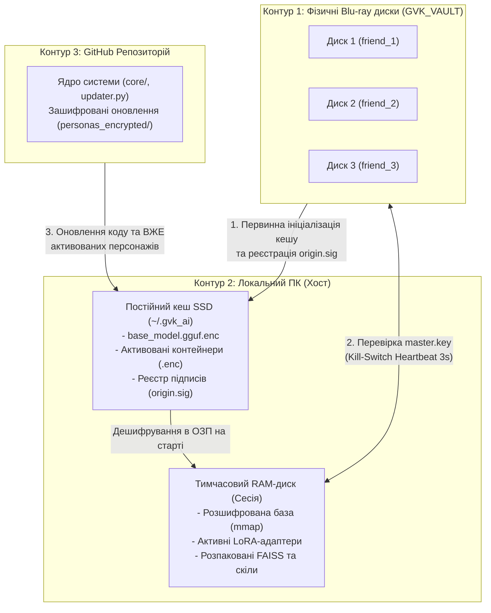

# GVK Private AI — Архітектура та Дорожня Карта Проекту

**GVK Private AI** — автономна мультиагентна LLM-система для симуляції живого спілкування та групових конференцій між цифровими копіями трьох учасників (`friend_1`, `friend_2`, `friend_3`).

Система використовує одну спільну квантовану базову модель (`Qwen2.5-7B-Instruct`), до якої в оперативній пам'яті динамічно підключаються персональні LoRA-адаптери, векторні бази спогадів (`FAISS`) та модулі індивідуальних скілів. Усі ваги, промпти та бази знань зашифровані (`AES-256-GCM`), а фізичні Blu-ray диски виступають одночасно «картриджами» доставки особистостей та апаратними ключами доступу (DRM).

---

## 1. Наскрізна архітектура системи

Інфраструктура розділена на три контури:
1. **Фізичні Blu-ray картриджі (`GVK_VAULT`)** — незмінні носії з базовою моделлю, ключем `master.key` та криптографічним підписом конкретного учасника `origin.sig`.
2. **Локальний ПК (Хост)** — дворівнева пам'ять: постійний зашифрований кеш на SSD (`~/.gvk_ai`) та тимчасовий розшифрований простір у RAM (існує лише під час сесії).
3. **GitHub Репозиторій** — хмарне сховище коду оркестратора та зашифрованих оновлень адаптерів/скілів.



### Логіка накопичувальної активації (Incremental Unlock)
* **Захист колекціонування (`origin.sig`):** На кожному диску лежить унікальний підпис `HMAC-SHA256(persona_id, master_key)`, якого немає у GitHub.
* **Перший диск:** Копіює зашифровану базову модель (~5 ГБ) на SSD, пакет першого друга та реєструє його `origin.sig`.
* **Наступні диски:** Базова модель пропускається; за кілька секунд докопійовуються лише новий адаптер, архів скілів та `origin.sig`.
* **Оновлення через GitHub (`updater.py`):** Стягує оновлення контейнерів лише для тих учасників, чий `origin.sig` вже зареєстрований локально.
* **Єдиний ключ запуску:** Оскільки `master.key` однаковий на всіх дисках, після активації всіх трьох учасників для запуску трійці достатньо будь-якого одного диска в приводі (або введення секретної фрази вручну через Argon2id).

---

## 2. Апаратні розрахунки та обсяги даних

| Компонент системи | Формат даних | Очікуваний розмір | Місце зберігання |
| :--- | :--- | :--- | :--- |
| **Базова модель 7B–8B** (основна) | `GGUF Q4_K_M` | 4.7–5.3 ГБ | Blu-ray та кеш SSD |
| **Базова модель 3B** (опціонально) | `GGUF Q4_K_M` | 1.9–2.2 ГБ | Blu-ray та кеш SSD |
| **LoRA-адаптер особистості** | `GGUF F16 / Q8_0` | 45–90 МБ | Blu-ray, GitHub, SSD |
| **Архів пам'яті та скілів (`payload`)** | `TAR.GZ` (FAISS + Py) | 5–25 МБ | Blu-ray, GitHub, SSD |
| **Сирий експорт чату (100к рядків)** | `JSON / JSONL` | 15–70 МБ | Тільки локально під час навчання |

* **Носій:** Одношаровий Blu-ray (BD-R SL, 25 ГБ) — збірка займає ~20% обсягу.
* **Швидкість читання BD:** Зовнішній USB (6x) — 25–27 МБ/с; внутрішній SATA (10x–12x) — 45–54 МБ/с.
* **Таймінги:** Холодний старт (копіювання бази з диска на SSD) — 1.5–3 хв. Теплий старт (перевірка 32-байтного ключа на диску + розшифрування з SSD у RAM) — 3–5 с.

---

## 3. Структура проекту та носіїв

### Файлова структура репозиторію (GitHub)

```text
gvk-private-ai/
├── updater.py                   # Перевірка диска, реєстрація origin.sig, git pull, завантаження llama-server
├── requirements.txt             # Залежності: cryptography, argon2-cffi, rich, requests, faiss-cpu, numpy
├── core/
│   ├── main.py                  # Головна точка входу, життєвий цикл сесії
│   ├── crypto_vault.py          # Монтування RAM-диска, AES-256-GCM, Argon2id та потік Kill-Switch
│   ├── menu.py                  # Термінальний інтерфейс (TUI) вибору режиму: Соло / Дует / Тріо
│   ├── orchestrator.py          # Керування контекстом, арбітр реплік та гарячий свічинг LoRA
│   ├── memory_rag.py            # Пошук спогадів та локального лору у векторній базі FAISS
│   └── skill_runner.py          # Пісочниця для виклику індивідуальних Python-функцій учасників
├── personas_encrypted/          # Хмарне сховище зашифрованих контейнерів для оновлення
│   ├── friend_1/                # manifest.json, adapter.gguf.enc, payload.tar.enc
│   ├── friend_2/
│   └── friend_3/
├── tools/                       # Інструментарій розробників (offline-пайплайн)
│   ├── tg_parser.py             # Очищення JSON-експорту чатів та склеювання реплік за тайм-аутом
│   ├── build_rag.py             # Генерація ембедінгів та збірка індексу memory.faiss
│   ├── train_lora.py            # Скрипт тренування QLoRA (Unsloth / Hugging Face PEFT)
│   └── disc_packer.py           # Генератор ключів, шифратор контейнерів та збирач образу диска
└── README.md
```

### Структура оптичного диска (`GVK_VAULT`)

```text
[Blu-ray Disc: GVK_VAULT]
├── run.bat / run.sh             # Автономні лаунчери-ініціалізатори (Windows / Linux / macOS)
├── vault/
│   └── master.key               # Сирий 256-бітний ключ (32 байти)
├── base/
│   └── base_model.gguf.enc      # Зашифрована базова модель (Qwen2.5-7B-Instruct Q4_K_M)
└── persona/
    ├── origin.sig               # HMAC-підпис фізичної активації конкретного друга (32 байти)
    ├── manifest.json            # Публічний паспорт (ID, версія, SHA-256 геші зашифрованих файлів)
    ├── adapter.gguf.enc         # Зашифровані ваги LoRA учасника
    └── payload.tar.enc          # Зашифрований архів: persona_config.json, prompt.txt, portrait.txt, memory.faiss, tools.py
```

---

## 4. Криптографія, Безпека та RAM-контур

Дотримується принцип **Zero-Plaintext-At-Rest** та **Zero-Leak Metadata**: жодні відкриті ваги, промпти, реальні імена чи тригери не зберігаються на SSD або у відкритому GitHub.

### Схема метаданих (Подвійний маніфест)
* **Публічний `manifest.json` (відкритий):** містить лише `persona_id` (`friend_1`), версію, назви `.enc` файлів та їхні `SHA-256` геші для перевірки цілісності модулем `updater.py`.
* **Приватний `persona_config.json` (усередині `payload.tar.enc`):** розшифровується тільки в RAM. Містить реальне ім'я для TUI, колір, гіперпараметри генерації (`temperature`, `top_p`, `repeat_penalty`), імовірність вступу в діалог (`chattiness_prob`), список `trigger_words` та опис скілів.

### Деривація ключа та формат `.enc`
* **Деривація (`Argon2id` → `AES-256-GCM`):** Парольна фраза (24+ символи) + фіксована сіль `GVK_PRIVATE_AI_DOMAIN_SALT_2026` (`time_cost=4`, `memory_cost=262144` / 256 МБ, `parallelism=4`, `hash_len=32`) → 32-байтний `master.key`.
* **Фоновий режим без диска:** Якщо оптичний привід із `vault/master.key` відсутній, `crypto_vault.py` запитує секретну фразу в консолі та генерує ключ у пам'яті.
* **Бінарний заголовок `.enc` контейнера (36 байтів + шифротекст):**

```text
+------------------+-------------------+-------------------+-------------------+------------------------+
| Magic Bytes (4B) |  File Nonce (12B) |   GCM Tag (16B)   |  Chunk Size (4B)  |   Ciphertext (N B)     |
|     "GVK1"       |  os.urandom(12)   |  Auth Tag AES-GCM |  uint32 (64 MB)   | Зашифрований потік даних|
+------------------+-------------------+-------------------+-------------------+------------------------+
```

### Ізоляція у RAM та Hardware Kill-Switch
* **Linux:** `tmpfs` у `/dev/shm/gvk_runtime_<pid>` (`chmod 700`).
* **macOS:** блоковий RAM-пристрій (`hdiutil attach -nomount ram://14680064`), APFS без індексації Spotlight.
* **Windows:** віртуальний диск / Memory-Mapped Anonymous Pipes із примусовим зануленням буфера перед закриттям.
* **Kill-Switch демон:** окремий потік кожні 3 секунди перевіряє наявність `vault/master.key` на диску (якщо сесія запущена з диска). При вийманні носія — `SIGKILL` для `llama-server` та миттєве очищення/демонтування RAM-диска.

---

## 5. Пайплайн даних, QLoRA та Оркестрація

### Підготовка датасету (`tools/tg_parser.py`)
1. **Очищення:** видалення системних подій, пересланих постів, порожніх лінків; заміна локальних стікерів текстовими токенами.
2. **Склеювання (`Message Chunking`):** об'єднання послідовних повідомлень одного автора з інтервалом `< 180 с` через `\n`.
3. **Нарізка контексту:** ковзне вікно по 6–12 реплік у форматі `ChatML` (цільовий друг = `assistant`).

### Гіперпараметри навчання (`tools/train_lora.py`)
* **База:** `Qwen2.5-7B-Instruct`
* **Маскування лоссу:** `train_on_responses_only` (градієнти лише на відповідях цільового учасника)
* **Конфігурація LoRA:** `r = 32`, `alpha = 64`, цільові модулі: всі 7 лінійних шарів (`q_proj`, `k_proj`, `v_proj`, `o_proj`, `gate_proj`, `up_proj`, `down_proj`)
* **Режим тренування:** `1.5 – 2.0` епохи, `LR = 1.5e-4` (Cosine), `warmup_ratio = 0.05`, оптимізатор `adamw_8bit`

### Оркестратор та гарячий свічинг (`core/orchestrator.py`)
* Запускається єдиний інстанс `llama-server` (`--ctx-size 8192 --mmap -ngl 99`), якому передаються базова модель та всі відкриті адаптери з початковою вагою `0.0`.
* Між репліками активний адаптер перемикається за `< 1 мс` через `POST /lora-adapters`.
* **Арбітр конференції (Cross-Talk Engine):**
  1. Прямий тег / `trigger_words` учасника (`P = 1.0`).
  2. Перехоплення за відповідністю запиту до скілів у `tools.py` (`Skill Match`).
  3. Спонтанна реакція (`Chattiness Roll` < `chattiness_prob`).
  4. Ліміт: максимум 2–3 репліки між ботами поспіль перед поверненням ходу користувачу.

---

## 6. Cyberpunk TUI та Фізичний сетап (GVK-DOCK & Interface)

### Двовіконний термінальний інтерфейс (`core/menu.py`)
Створюється через бібліотеку `rich.layout.Layout` у стилі Industrial Cyberpunk / Cassette Futurism. Екран розділений на дві робочі зони:

```text
┌─── GVK PRIVATE AI // LIVE CONSOLE ───────┬─── SUBJECT: FRIEND_01 [ACTIVE] ───┐
│                                          │          .---.                    │
│ [12:40] Ти: Хто пам'ятає, куди ми поділи │         /     \     ASCII-ПОРТРЕТ │
│         той старий мангал?               │        | () () |    ДРУГА         │
│                                          │         \  -  /     (з portrait   │
│ [12:41] [Друг 1]:                        │          /`---'\     .txt)        │
│         В гаражі на нижній полиці під    │         /       \                 │
│         колесами лежить. Я його ще восени│        / /|   |\ \                │
│         змастив, якщо ти не забув.       │       (_/ |___| \_)               │
│                                          ├───────────────────────────────────┤
│ [12:41] [Друг 2]:                        │  // DOSSIER & METRICS             │
│         Бреше він, ми його на дачі       │  Ім'я: Гліб [CODE_NAME: CYBER]    │
│         забули біля бані.                │  Роль: Архітектор / Dev           │
│                                          │  Стиль: Сарказм, лаконічність     │
│ [Введіть повідомлення] >                 │  Шанс вступу в діалог: 45%        │
│ █                                        │  Тригери: "код", "матан", "глянь" │
│                                          │  Скіл: tools.analyze_code() [OK]  │
└──────────────────────────────────────────┴───────────────────────────────────┘
```

* **Ліва зона (60% ширини):** Живий потік діалогу з колірним маркуванням реплік та таймстемпами.
* **Права верхня зона:** Портрет поточного мовця з ASCII-символів (`portrait.txt`), що розшифровується з `payload.tar.enc`.
* **Права нижня зона:** Досьє, роль, тригерні слова, рівень балакучості та статус готовності індивідуальних Python-скілів.
* **Динамічний фокус (Тріо-режим):** Коли репліку перехоплює інший друг, права панель на льоту змінює портрет, досьє та колір рамки (🔵 Cyan / 🟡 Amber / 🟣 Violet).

### Настільна станція `GVK-DOCK // MK.I` та Колекційний бокс
* **Стенд-консоль:** Настільна док-станція (3D-друк або лазерна порізка з матового чорного акрилу) з вбудованим відсіком під Slim USB Blu-ray привід та трьома похилими слотами-касетницями під коробки дисків.
* **Апаратний тумблер Kill-Switch:** Справжній авіаційний тумблер під червоною захисною кришкою («Missile Switch»), що розриває живлення USB-приводу для миттєвого апаратного скидання сесії демоном `crypto_vault.py`.
* **Колекційне оформлення:** Матові чорні бокси з картонними рукавами (Slipcase), роздруковані секретні досьє суб'єктів на цупкому папері та картки відновлення `RECOVERY CIPHER CARD` із загадкою для деривації ключа Argon2id.

---

## 7. Дорожня карта та розподіл задач (Roadmap)

Робота розділена на два паралельні треки для двох розробників із чіткими точками синхронізації.

| Фаза | Трек А: ML, Датасет, RAG та Скіли | Трек Б: Криптографія, Інфраструктура та Ядро | Точка синхронізації (Milestone) |
| :--- | :--- | :--- | :--- |
| **Етап 1** | Розробка `tools/tg_parser.py`, очищення чатів, збірка ChatML датасетів | Розробка `tools/disc_packer.py` та `core/crypto_vault.py` (Argon2id, AES-GCM, RAM-диск) | Тестове шифрування та дешифрування файлу в ОЗП |
| **Етап 2** | Навчання 3 QLoRA-адаптерів на Qwen2.5-7B, конвертація у GGUF | Розробка `updater.py`, перевірки `origin.sig` та автозавантаження `llama-server` | Готові адаптери та працюючий синхронізатор кешу |
| **Етап 3** | Збірка індексів `memory.faiss` (`build_rag.py`), створення `prompt.txt`, `portrait.txt` та `tools.py` | Розробка `orchestrator.py` (LoRA-свічинг, Cross-Talk арбітр), `memory_rag.py`, `skill_runner.py` та кіберпанк TUI `menu.py` | Повноцінна локальна конференція трьох ботів із візуальним TUI |
| **Етап 4** | Пакування `payload.tar.enc` для всіх учасників, валідація діалогів | Тестування Kill-Switch (включно з апаратним тумблером), запис 3 Blu-ray дисків `GVK_VAULT` | Реліз `v1.0.0` та фізичний обмін дисками |

### Чекліст виконання

> [!IMPORTANT]
> **Як відмічати пункти кліком мишки:** GitHub блокує кліки по чекбоксах напряму у файлі `README.md` (тут вони працюють як візуальне табло). Щоб **клікати мишкою по чекбоксах** і бачити живу смугу прогресу, відкрийте прикріплений Issue:
>
> 👉 **[Відкрити інтерактивний чекліст (Issue #1) — клікати тут](https://github.com/Holii-1/Private-AI-Companion-GVK-/issues/1)**
>
> *(Коли ви ставите галочку в [Issue #1](https://github.com/Holii-1/Private-AI-Companion-GVK-/issues/1), GitHub Action автоматично оновлює галочки і в цьому `README.md`!)*

<!-- CHECKLIST_START -->
#### Етап 1: Фундамент та даних/крипто-пайплайн
- [ ] **[Трек А]** Реалізувати парсер Telegram-експорту (`tools/tg_parser.py`) зі склеюванням реплік (`< 180s`) та фільтрацією сміття.
- [ ] **[Трек А]** Сформувати тренувальні вибірки у форматі ChatML для 3 учасників.
- [ ] **[Трек Б]** Реалізувати генерацію ключа `Argon2id` та потокове шифрування/дешифрування `AES-256-GCM` (`tools/disc_packer.py`, `core/crypto_vault.py`).
- [ ] **[Трек Б]** Реалізувати кросплатформне монтування RAM-диска (Linux/macOS/Windows).
- [ ] **[Milestone 1]** Успішний тест: зашифрувати тестовий контейнер і розпакувати його напряму в RAM-диск.

#### Етап 2: Тренування моделей та система доставки
- [ ] **[Трек А]** Навчити 3 QLoRA-адаптери (`tools/train_lora.py`) на базі `Qwen2.5-7B-Instruct` та експортувати у `GGUF`.
- [ ] **[Трек Б]** Написати `updater.py`: ініціалізація `~/.gvk_ai`, верифікація `origin.sig`, звірка `manifest.json` та завантаження бінарника `llama-server`.
- [ ] **[Milestone 2]** Адаптери підготовлені та успішно проходять перевірку цілісності через `updater.py`.

#### Етап 3: RAG, Скіли, Оркестратор та TUI
- [ ] **[Трек А]** Зібрати векторні бази `memory.faiss` (`tools/build_rag.py`) для кожного учасника.
- [ ] **[Трек А]** Створити системні промпти (`prompt.txt`), ASCII-портрети (`portrait.txt`), конфіги (`persona_config.json`) та індивідуальні функції (`tools.py`).
- [ ] **[Трек Б]** Реалізувати `core/orchestrator.py` (керування `llama-server`, гарячий свічинг LoRA, алгоритм арбітра Cross-Talk).
- [ ] **[Трек Б]** Інтегрувати `core/memory_rag.py`, пісочницю `core/skill_runner.py` та двовіконний TUI `core/menu.py` (live-чат, динамічні ASCII-портрети, досьє).
- [ ] **[Milestone 3]** Запуск повноцінної групової сесії трьох ботів у Тріо-режимі з пам'яттю, скілами та візуальним TUI.

#### Етап 4: Фінальне пакування та запис дисків
- [ ] **[Трек А]** Запакувати фінальні `payload.tar.enc` та `adapter.gguf.enc`, провести тюнінг `temperature` та `chattiness_prob`.
- [ ] **[Трек Б]** Відтестувати фоновий потік Kill-Switch (включно з апаратним тумблером) та стартові скрипти `run.sh` / `run.bat`.
- [ ] **[Трек Б]** Зібрати фінальні ISO-образи та записати 3 фізичні Blu-ray диски `GVK_VAULT`.
- [ ] **[Milestone 4]** Реліз `v1.0.0`.
<!-- CHECKLIST_END -->
