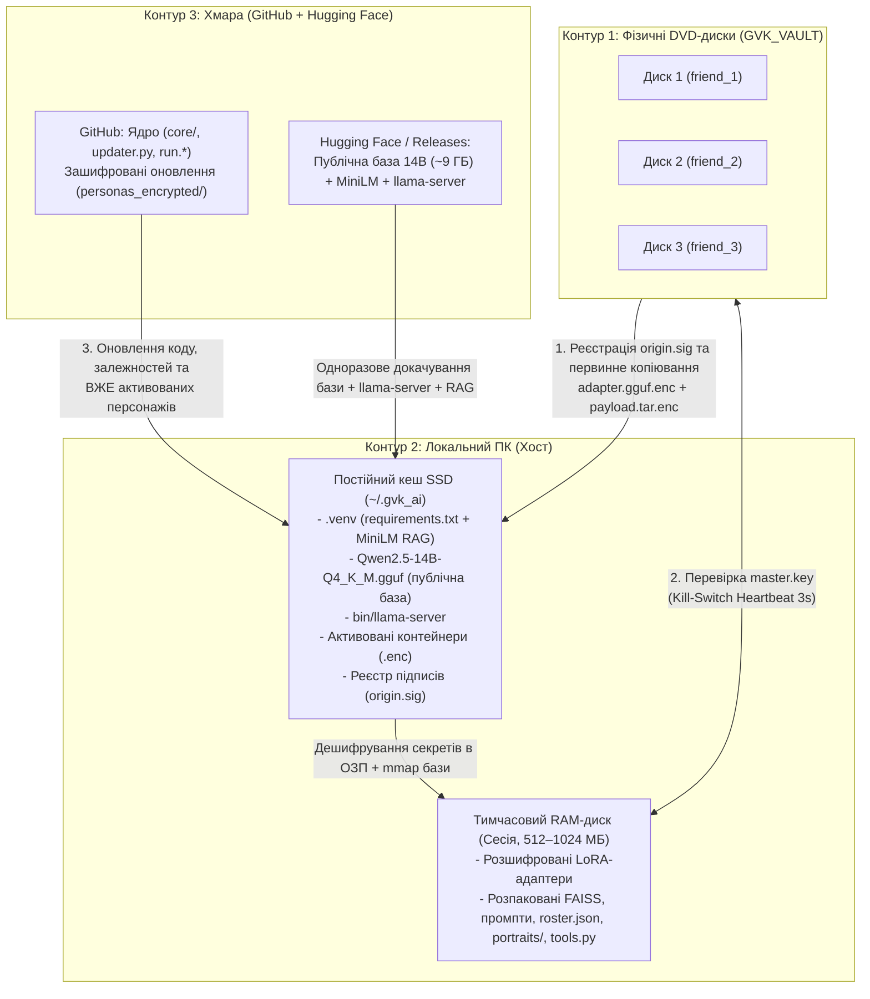
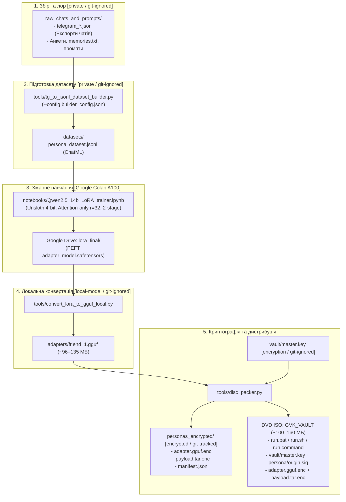

# GVK Private AI — Архітектура, Запуск та Дорожня Карта Проекту

**GVK Private AI** — автономна локальна LLM-система для живого спілкування (Соло, а згодом Дует / Тріо) із цифровими копіями учасників (`friend_1`, `friend_2`, `friend_3`).

Система використовує одну спільну квантовану базову модель (`Qwen2.5-14B-Instruct`), до якої в оперативній пам'яті динамічно підключаються персональні LoRA-адаптери (`--lora-scaled`), векторні бази спогадів (`FAISS` + `sentence-transformers`) та модулі індивідуальних скілів (`tools.py`). Усі персональні ваги, промпти, реальні імена (`roster.json`), портрети, спогади та скіли зашифровані (`AES-256-GCM`), а фізичні **DVD-диски (`GVK_VAULT`)** виступають одночасно «картриджами» доставки особистостей та апаратними ключами доступу (DRM + Kill-Switch).

---

## 0. Швидкий запуск (Zero-Install: новий ПК або локальне репо)

### Що потрібно на новому пристрої
* **Жодних попередніх встановлень не потрібно** — ні `Git`, ні `Python`, ні `Homebrew`, ні прав адміністратора.
* **Windows 10/11, macOS, Linux:** достатньо інтернету на **перший запуск** (~9.5 ГБ для одноразового кешу `~/.gvk_ai`: базова модель 14B, `llama-server`, RAG-енкодер та за потреби портативний Python 3.12 + Tk). Починаючи з 2-го запуску система працює повністю **офлайн**.
* **Залізо:** рекомендовано **16+ ГБ RAM** (Apple Silicon Metal / Windows Vulkan GPU або CPU) та ~12 ГБ вільного місця на SSD.

### Запуск із DVD-диска `GVK_VAULT` (або з клонованого репо)

* **Windows:** двічі клікніть `run.bat` у корені диска (або `run.bat` у консолі).
* **macOS:** двічі клікніть `run.command` у Finder або запустіть `./run.sh` у терміналі.
* **Linux:** запустіть `./run.sh`.

**Що відбувається автоматично на першому запуску:**
1. Якщо запуск іде з DVD — ядро клонується через `git` (якщо є) або **автоматично скачується архівом без Git** через вбудований `curl` + `tar` у `~/.gvk_ai/repo`.
2. Якщо в системі немає `Python >= 3.10` із `Tk >= 8.6` — лаунчер **сам завантажує портативний Python 3.12 + Tcl/Tk 8.6** (`astral-sh/python-build-standalone`, ~35 МБ) у `~/.gvk_ai/python/`.
3. `updater.py` створює `.venv` і встановлює залежності з `requirements.txt`.
4. Верифікується `vault/master.key`, `persona/origin.sig`, SHA-256 у `manifest.json` та імпортуються `.enc` контейнери в `~/.gvk_ai/personas/` (на наступних запусках повторне копіювання з DVD пропускається).
5. Один раз завантажуються у `~/.gvk_ai/`:
   * базова модель `Qwen2.5-14B-Instruct-Q4_K_M.gguf` (~9.0 ГБ, із докачуванням HTTP Range);
   * бінарник `llama-server` із GitHub Releases `ggml-org/llama.cpp` (macOS ARM64/x64, Windows Vulkan/CPU, Linux);
   * ембедінг-модель RAG `paraphrase-multilingual-MiniLM-L12-v2` (~470 МБ).
6. `core/main.py` монтує ізольований RAM-диск, розшифровує особистість у ОЗП, запускає Kill-Switch демон і відкриває термінальний GUI (`core/menu.py`).

### Додаткові режими лаунчера
```bash
./run.sh --fast         # Прискорений запуск (короткі таймери інтро-екранів)
./run.sh status         # Діагностика кешу ~/.gvk_ai, .venv, моделі, llama-server і DVD
./run.sh self-test      # Повна офлайн-самоперевірка всіх модулів ядра
```
*(Ті самі команди підтримує `run.bat`: `run.bat --fast`, `run.bat status`, `run.bat self-test`.)*

---

## 1. Наскрізна архітектура системи

Інфраструктура розділена на три контури:
1. **Фізичні DVD-картриджі (`GVK_VAULT`)** — незмінні оптичні носії (~100–160 МБ даних на диску) з ключем `master.key`, криптографічним підписом конкретного учасника `origin.sig`, його зашифрованим LoRA-адаптером (`adapter.gguf.enc`), архівом пам'яті/ростера/скілів (`payload.tar.enc`) та Zero-Install лаунчерами `run.bat` / `run.sh` / `run.command`.
2. **Локальний ПК (Хост)** — дворівнева пам'ять: постійний кеш на SSD (`~/.gvk_ai` з публічною базовою моделлю, `.venv`, `llama-server` та зашифрованими `.enc` контейнерами) і тимчасовий розшифрований простір у RAM (існує лише під час сесії для приватних LoRA, промптів, `roster.json`, FAISS і скілів).
3. **Хмарний контур (GitHub + Hugging Face)** — GitHub зберігає лише знеособлений код ядра (`core/`, `updater.py`, `run.sh`, `run.bat`, `requirements.txt`) і зашифровані оновлення (`personas_encrypted/`), а з Hugging Face / GitHub Releases при першому запуску автоматично завантажуються базова модель (~9.0 ГБ), RAG-енкодер (~470 МБ) та `llama-server`.



### Логіка накопичувальної активації (Incremental Unlock) та роботи `updater.py`
* **Захист колекціонування (`origin.sig`):** На кожному DVD лежить унікальний підпис `HMAC-SHA256(persona_id, master_key)`, якого немає у відкритому GitHub.
* **Перевірка залежностей (`requirements.txt`):** `updater.py` (працює на чистій stdlib Python) перевіряє версію Python (`>= 3.10`) та Tcl/Tk (`>= 8.6`), розгортає `.venv` і звіряє SHA-256 маркер `requirements.txt`.
* **Перший диск:** Копіює з DVD пакет першого друга (`adapter.gguf.enc`, `payload.tar.enc`, `manifest.json`) без Read-Only біта DVD, реєструє його `origin.sig`, а `updater.py` один раз докачує базову модель, `llama-server` і RAG-енкодер.
* **Наступні диски:** Базова модель і `.venv` вже готові; з DVD за секунди докопійовуються лише новий адаптер, `payload.tar.enc` та `origin.sig`.
* **Оновлення через GitHub (`updater.py`):** Стягує оновлення `.enc` контейнерів лише для тих учасників, чий `origin.sig` вже зареєстрований локально (і не відкочує їх старішою версією з DVD).
* **Єдиний ключ запуску:** Оскільки `master.key` однаковий на всіх дисках, після активації кількох учасників достатньо будь-якого одного DVD в приводі (або введення майстер-фрази вручну через Argon2id).

---

## 2. Апаратні розрахунки та обсяги даних

| Компонент системи | Формат даних | Очікуваний розмір | Місце зберігання |
| :--- | :--- | :--- | :--- |
| **Базова модель (`Qwen/Qwen2.5-14B-Instruct`)** | `GGUF Q4_K_M` | ~9.0 ГБ | Хмара (HF) → кеш SSD (`~/.gvk_ai/base/`) |
| **RAG-енкодер (`paraphrase-multilingual-MiniLM-L12-v2`)** | HuggingFace cache | ~470 МБ | Хмара (HF) → кеш `.venv` / HF cache |
| **LoRA-адаптер особистості** | `GGUF F16 / Q8_0` | ~96–135 МБ | DVD, GitHub, SSD (`.enc`) → RAM |
| **Архів пам'яті, портретів, ростера та скілів (`payload`)** | `TAR.GZ` (FAISS + JSON + Py) | 0.15–25 МБ | DVD, GitHub, SSD (`.enc`) → RAM |
| **Сирий експорт чату та датасет** | `JSON / JSONL` | 70–75 МБ | Тільки локально під час навчання |

* **Носій:** Стандартний одношаровий **DVD-R (4.7 ГБ)** (або навіть CD-R 700 МБ) — пакет одного учасника займає **~100–160 МБ** (~2–3.5% обсягу DVD).
* **Таймінги:** Перший запуск (одноразове завантаження ~9.5 ГБ + `.venv`) — ~3–8 хв залежно від каналу. Теплий старт (перевірка `master.key` + розшифрування в RAM + `mmap` бази) — **3–5 с**, працює повністю **офлайн**.
* **Сумісність із 16 ГБ RAM (MacBook / ноутбуки):** Публічна базова модель (~9.0 ГБ) підключається у `llama-server` напряму з SSD через `--mmap` без копіювання в RAM-диск, а в ізольований RAM-диск (`512–1024 МБ`) розшифровуються лише приватні файли.

---

## 3. Структура проекту та носіїв

### Конвенція тегів приватності та контролю версій
Усі компоненти розділені за рівнем приватності (принцип **Zero-Leak / Zero-Plaintext-At-Rest**):
* `[git-tracked]` — знеособлений код ядра, лаунчери, інструменти, 3D-моделі, ноутбуки та CI/CD.
* `[private / git-ignored]` — конфіденційні дані (`personas/`, `roster.json`, `tools.py`, `data/`, `datasets/`, `raw_chats_and_prompts/`, `logs/`, `backups/`). Суворо блокуються у `.gitignore`.
* `[local-model / git-ignored]` — локальні ваги моделей та рантайм (`base/`, `adapters/`, `lora_final/`).
* `[encryption / git-ignored]` — криптографічні секрети нульового контуру (`vault/master.key`, `origin.sig`, `dist/`, `*.iso`).
* `[build-cache / git-ignored]` — кеш збірки та віртуальне середовище (`.venv/`, `build/`).
* `[encrypted / git-tracked]` — зашифровані `AES-256-GCM` контейнери (`personas_encrypted/<id>/{adapter.gguf.enc,payload.tar.enc,manifest.json}`).

### Файлова структура репозиторію та локального середовища

```text
gvk/
├── .github/                     # [git-tracked] CI/CD автоматизація
│   └── workflows/
│       └── sync-checklist.yml   # Автоматична синхронізація чекліста з GitHub Issue #1
├── adapters/                    # [local-model / git-ignored] Локальні ваги LoRA (.gguf)
│   └── friend_1.gguf
├── backups/                     # [private / git-ignored] Локальні бекапи конфігів/параметрів
├── base/                        # [local-model / git-ignored] Базова модель та опційний рантайм
├── build/                       # [build-cache / git-ignored] Кеш конвертера llama.cpp
├── core/                        # [git-tracked] Ядро системи, рантайм та крипто-сховище
│   ├── __init__.py
│   ├── crypto_vault.py          # RAM-диск, AES-256-GCM, Argon2id, Kill-Switch демон
│   ├── main.py                  # Головна точка входу, життєвий цикл сесії, логування
│   ├── menu.py                  # Термінальний Tkinter GUI (1280x720), Braille-портрети, чат
│   ├── orchestrator.py          # Контекст, RAG, slash/auto-скіли, llama-server, Cross-Talk
│   ├── memory_rag.py            # Гібридний векторний + лексичний RAG (FAISS / ngram)
│   └── skill_runner.py          # 3-рівнева пісочниця скілів + slash-команди + тригери
├── data/                        # [private / git-ignored] memories.txt, memory.faiss, конфіги білдера
├── datasets/                    # [private / git-ignored] Скомпільовані ChatML-датасети (.jsonl)
├── dist/                        # [encryption / git-ignored] Зібрані папки DVD та .iso образи
├── hardware/                    # [git-tracked] 3D-моделі док-станції GVK-DOCK (.obj/.mtl/.html)
├── logs/                        # [private / git-ignored] Логи сесій та llama_server.log
├── notebooks/                   # [git-tracked] Google Colab QLoRA 2-stage ноутбук
│   └── Qwen2.5_14b_LoRA_trainer.ipynb
├── personas/                    # [private / git-ignored] Локальні розшифровані дані персонажів
│   ├── roster.json              # Реальні імена UI, сплеш-екрани та описи співрозмовників
│   └── friend_1/                # persona_config.json, prompt.txt, memory.faiss, portraits/, roster.json, tools.py
├── personas_encrypted/          # [encrypted / git-tracked] Хмарне сховище зашифрованих оновлень
│   ├── friend_1/                # manifest.json, adapter.gguf.enc, payload.tar.enc
│   ├── friend_2/
│   └── friend_3/
├── raw_chats_and_prompts/       # [private / git-ignored] Сирі Telegram-експорти, анкети, промпти
├── tools/                       # [git-tracked] Offline-пайплайн розробників
│   ├── tg_to_jsonl_dataset_builder.py # Експорт Telegram -> зважений ChatML JSONL (підтримує --config)
│   ├── convert_lora_to_gguf_local.py  # Локальний конвертер PEFT LoRA -> GGUF F16
│   ├── ascii_portrait.py        # Фото -> Braille/ASCII спрайти емоцій
│   ├── train_lora.py            # CLI-скрипт тренування QLoRA та dry-run перевірки
│   ├── build_rag.py             # Збірка автономного memory.faiss (із трейлером GVKMETA1)
│   └── disc_packer.py           # Keygen, AES-GCM пакувальник, збірка DVD і pure-Python ISO-9660/Joliet
├── vault/                       # [encryption / git-ignored] 256-бітний ключ master.key
├── run.sh                       # [git-tracked] Універсальний лаунчер (macOS / Linux, LF)
├── run.bat                      # [git-tracked] Універсальний лаунчер (Windows, CRLF)
├── updater.py                   # [git-tracked] Автоналаштування .venv, DVD, GitHub-оновлень і моделей
├── requirements.txt             # [git-tracked] Залежності Python (>=3.10, Tk >=8.6)
├── .gitattributes               # [git-tracked] Фіксація LF для *.sh та CRLF для *.bat
├── .gitignore                   # [git-tracked] Бар'єр приватності Zero-Leak
└── README.md                    # [git-tracked] Документація та дорожня карта
```

### Життєвий цикл даних (Data Lifecycle Flow)



### Структура оптичного диска (`GVK_VAULT`)

```text
[DVD Disc: GVK_VAULT (~100-160 МБ)]
├── run.bat / run.sh / run.command # Автономні Zero-Install лаунчери (Windows / Linux / macOS Finder)
├── vault/
│   └── master.key               # Сирий 256-бітний ключ (32 байти)
└── persona/
    ├── origin.sig               # HMAC-підпис фізичної активації конкретного друга (32 байти)
    ├── manifest.json            # Публічний паспорт (ID, версія, SHA-256 геші .enc файлів)
    ├── adapter.gguf.enc         # Зашифрований LoRA-адаптер учасника
    └── payload.tar.enc          # Зашифрований TAR.GZ: persona_config.json, prompt.txt, roster.json, portraits/, memory.faiss, tools.py
```

---

## 4. Криптографія, Безпека та RAM-контур

Дотримується принцип **Zero-Plaintext-At-Rest** та **Zero-Leak Metadata**: жодні відкриті ваги, промпти, реальні імена (`roster.json`), тексти скілів чи спогади не зберігаються в GitHub або у відкритому вигляді на SSD (навіть системний промпт не пишеться у логи `logs/`).

### Схема метаданих (Подвійний маніфест)
* **Публічний `manifest.json`:** містить лише `persona_id` (`friend_1`), версію, назви `.enc` файлів та їхні `SHA-256` геші.
* **Приватні файли усередині `payload.tar.enc`:** розшифровуються виключно в RAM (`persona_config.json`, `roster.json`, `prompt.txt`, `memory.faiss`, `portraits/`, `tools.py`). Під час пакування `pack_payload_encrypted()` рекурсивно відфільтровує службове сміття (`.*`, `__pycache__`, `raw/`, `.psd`, `.xcf`, `.pyc`).

### Деривація ключа та формат `.enc`
* **Деривація (`Argon2id` → `AES-256-GCM`):** Парольна фраза (24+ символи) + фіксована сіль `GVK_PRIVATE_AI_DOMAIN_SALT_2026` (`time_cost=4`, `memory_cost=262144` / 256 МБ, `parallelism=4`, `hash_len=32`) → 32-байтний `master.key`.
* **Режим без диска:** якщо DVD із `vault/master.key` не вставлено, `crypto_vault.py` запитує секретну фразу в консолі та обчислює ключ в ОЗП.
* **Бінарний заголовок `.enc` контейнера (36 байтів + потоковий шифротекст чанками по 64 МБ):**

```text
+------------------+-------------------+-------------------+-------------------+------------------------+
| Magic Bytes (4B) |  File Nonce (12B) |  Header Tag (16B) |  Chunk Size (4B)  |   Ciphertext (N B)     |
|     "GVK1"       |  os.urandom(12)   |  HMAC-SHA256[:16] |  uint32 (64 MB)   | AES-256-GCM чанки      |
+------------------+-------------------+-------------------+-------------------+------------------------+
```

### Ізоляція у RAM та Hardware Kill-Switch (`core/crypto_vault.py`)
* **Linux:** `tmpfs` у `/dev/shm/gvk_runtime_<pid>` (`chmod 700`).
* **macOS:** блоковий RAM-пристрій (`hdiutil attach -nomount ram://<sectors>`), HFS+ із правами `0700` (`nobrowse,noowners,nosuid`) та вимкненим Spotlight (`mdutil -i off`, `.metadata_never_index`); у пісочниці — ізольований буфер із затиранням нулями `0x00`.
* **Windows:** віртуальний RAM-диск `ImDisk` або ізольований сесійний буфер `0700` із примусовим зняттям Read-Only та по-байтовим затиранням нулями `0x00`.
* **Kill-Switch демон:** кожні 3 секунди перевіряє наявність `vault/master.key` на диску. При вийманні DVD або спрацюванні тумблера `GVK-DOCK` — `SIGKILL` для `llama-server`, пауза `0.25 с` для звільнення дескрипторів, затирання ключа та файлів у RAM нулями (`0x00`) і демонтування RAM-диска.

### Повний цикл пакування DVD та ISO (`tools/disc_packer.py`)

```bash
# 0. Самоперевірка криптографічного ядра та ISO-збирача
python3 tools/disc_packer.py self-test

# 1. Генерація 32-байтного ключа master.key (майстер-фраза вводиться приховано)
python3 tools/disc_packer.py keygen -o vault/master.key

# 2. Пакування особистості (створює adapter.gguf.enc, payload.tar.enc, manifest.json, origin.sig)
python3 tools/disc_packer.py pack-persona \
  -k vault/master.key \
  --id friend_1 \
  --adapter adapters/friend_1.gguf \
  --payload-dir personas/friend_1/ \
  -o personas_encrypted/friend_1/

# 3. Збірка дерева DVD-диска GVK_VAULT (із актуальними run.bat, run.sh та run.command)
python3 tools/disc_packer.py build-disc \
  -k vault/master.key \
  --id friend_1 \
  --persona-dir personas_encrypted/friend_1/ \
  -o dist/GVK_VAULT_DISC_1/

# 4. Генерація готового образу ISO-9660 + Joliet для запису на фізичний DVD-R
python3 tools/disc_packer.py build-iso \
  -i dist/GVK_VAULT_DISC_1/ \
  -o dist/GVK_VAULT_DISC_1.iso \
  --volume-name GVK_VAULT
```

---

## 5. Пайплайн даних, QLoRA, RAG, Скіли та Оркестрація

### Підготовка датасету (`tools/tg_to_jsonl_dataset_builder.py`)
* Обробляє експорти особистих і групових чатів Telegram у формат ChatML JSONL із суворою ізоляцією чатів.
* Підтримує приватні мапінги через `--config <builder_config.json>` (дефолти в коді повністю знеособлені).
* Застосовує Golden Rules для медіа/голосових, фільтрацію шуму/VoIP-координації, ковзне вікно (`MAX_TURNS_PER_SAMPLE = 32`, `CHUNK_OVERLAP_TURNS = 4`), хронологічне сортування та часове зважування (`1x` / `1x` / `2x`).

```bash
python3 tools/tg_to_jsonl_dataset_builder.py --config data/builder_config_friend_1.json
```

### Хмарне 2-стадійне тренування QLoRA (`notebooks/Qwen2.5_14b_LoRA_trainer.ipynb`)
* **База:** `unsloth/Qwen2.5-14B-Instruct-bnb-4bit`, `max_seq_length = 4096`.
* **LoRA:** Attention-only (`q_proj`, `k_proj`, `v_proj`, `o_proj`), `r = 32`, `alpha = 48` (`alpha/r = 1.5`), `dropout = 0.0` — зберігає енциклопедичні знання бази та чітко закріплює стиль персонажа.
* **Маскування лоссу:** `train_on_responses_only` (тільки репліки `assistant`).
* **Stage 1:** повний датасет, `lr = 1.0e-4`, cosine scheduler, 1 епоха, effective batch size `8`.
* **Stage 2 (Style Annealing):** топ-20% дедуплікованих сучасних лаконічних діалогів (`STAGE2_TOP_FRACTION = 0.20`), `lr = 2e-5`, cosine, `weight_decay = 0.05`.
* **Конвертація локально:** `python3 tools/convert_lora_to_gguf_local.py` (стягує лише ~10 МБ конфігів/токенізатора, видає `adapters/friend_1.gguf`).

### Векторна пам'ять RAG (`tools/build_rag.py` та `core/memory_rag.py`)
* Парсить структуровані блоки `[MEMORY_XX]` (`Категория:`, `Теги:`, `Содержание:`) та прості `.txt`/`.md`/`.json`/`.jsonl`.
* **Основний бекенд:** `sentence-transformers/paraphrase-multilingual-MiniLM-L12-v2` (384 dim, поріг релевантності `DEFAULT_ST_SIMILARITY_THRESHOLD = 0.72`) + `faiss.IndexFlatIP` + крос-мовний гібридний бустинг **UA / RU / суржик** (приватні синоніми та аліаси підвантажуються в RAM із `persona_config.json -> rag_lexicon`).
* **Офлайн-фолбек:** 384-мірний feature-hashing (`ngram`, `GVKRAG01`).
* **Автономний індекс:** метадані вшиваються прямо в `memory.faiss` (трейлер `GVKMETA1`), тому файл працює всередині `payload.tar.enc` без зовнішніх JSON.
* **Контекстне вікно пошуку:** оркестратор використовує `2-turn window` (`build_rag_query`) і фільтрує порожні привітання.

```bash
python3 tools/build_rag.py -i data/memories.txt -o personas/friend_1/memory.faiss
python3 core/memory_rag.py self-test
```

### Пісочниця індивідуальних скілів (`core/skill_runner.py`)
Кожен учасник може мати власний приватний `tools.py` (усередині `payload.tar.enc`) + метадані скілів у `persona_config.json`:
1. **3-рівнева ізоляція:** статичний AST-валідатор (лише безпечні модулі `math`, `random`, `datetime`, `hashlib`, `re`, `json` тощо; блок `os`/`subprocess`/`open`/`eval`/dunder), чистий `__builtins__`, запуск у субпроцесі з тайм-аутом (`3.0 с`) та лімітом виводу (`2000` симв.).
2. **Подвійний виклик (Slash + Auto-Keywords):**
   * **Slash-команди:** `/команда [аргументи]` (плюс аліаси з `persona_config.json` і вбудована довідка `/skills` / `/скіли` / `/help`). Пропускає зайвий RAG і передає точний результат моделі для відповіді у стилі персонажа.
   * **Авто-тригер за ключовими словами (`execute_for_query`):** розпізнає природні фрази користувача з перевіркою меж слів (без хибних спрацьовувань на звичайний текст).
   * **Фолбек тегів LLM:** безпечний парсер `[SKILL: func_name(arg=val)]` через `ast.parse` + `ast.literal_eval`.
3. **Досьє під портретом:** автоматично форматує активні скіли у вигляді `• <як викликати> - <що робить>` із приватного `persona_config.json`.

```python
@skill(
    triggers=["чек", "розділити рахунок"],
    description="Ділить суму між учасниками.",
    slash="/чек",
    slash_aliases=["/split"],
    usage="/чек <сума> [людей]",
    short_desc="ділить чек",
)
def calc_split(total: float, people: int = 2) -> str:
    return f"По {round(total / people, 2)} з кожного"
```

### Оркестратор (`core/orchestrator.py`)
* Запускає `llama-server` із параметрами з `persona_config.json` (`--lora-scaled`, `--temp`, `--top-p`, `--min-p`, `--repeat-penalty`, `--presence-penalty`, `--dry-multiplier`, `--n-predict`, без `-ngl` для авто-офлоуду GPU).
* Вивід `llama-server` пишеться в `logs/llama_server.log` із діагностикою останніх рядків у разі збою.
* Підтримує динамічну дату/вік (`birth_date`), ін'єкцію співрозмовника з `roster.json` / `persona_config.json`, фоновий прогрів (`warmup_questions`), гарячий свічинг `POST /lora-adapters` і Cross-Talk арбітр (word-boundary `trigger_words` + Skill Match + `chattiness_prob`).

---

## 6. Термінальний GUI (`core/menu.py`) та Фізичний сетап (`GVK-DOCK`)

### Ретро-термінальний інтерфейс (`core/menu.py`)
Побудований на стандартному **Tkinter** (`1280×720`, фіксоване вікно, моноширинний шрифт, приглушена термінальна палітра):

(previously 1.1.0 - Hopeful Dawn)
```text
┌─────────── GVK PRIVATE AI [Release 1.1.1 - Optical Funeral] ───────────┐
│  [Braille-портрет 4 стани]   │ [Користувач]                         │
│  idle / sleeping / smiling   │   /команда або звичайний текст       │
│  talking / talking2          │                                      │
│──────────────────────────────│ [Персонаж]                           │
│  Ім'я, вік                   │   Жива відповідь у стилі учасника    │
│  Короткий опис та стиль      │   із порядковою появою реплік        │
│  RAG: 62 спогадів [OK]       │                                      │
│  Скіли: активних: 4 [OK]     │                                      │
│  • /команда <арг> - опис     │──────────────────────────────────────│
│  Стан: [IDLE]                │ > _                                  │
└──────────────────────────────┴──────────────────────────────────────┘
```

* **Ліва панель:** висококонтрастний Braille-портрет (`BraillePortraitCanvas`, генерується `tools/ascii_portrait.py`), автоматична анімація `idle` → `talking`/`talking2` → `smiling` → `sleeping` (AFK), досьє, статус RAG та список скілів (`як викликати - що робить`).
* **Права панель:** живий чат із плавним автоскролом, індикатором набору, вставкою `Ctrl+V`/`Cmd+V` (на будь-якій розкладці), багаторядковим вводом `Shift+Enter`, скиданням діалогу `CTRL+N`, поверненням `ESC` та виходом `CTRL+C`.
* **Екрани входу:** сплеш-екран, попередження, вибір профілю з прихованим розблокуванням `sudo` (працює на EN/DE/UA/RU розкладках), кастомним вводом `[17]` та екраном фонового прогріву моделі.

### Настільна станція `GVK-DOCK // MK.I`
* **3D-моделі (`hardware/`):** корпус під Slim USB DVD-привід і 3 слоти-касетниці (`gvk_dock_mk1.obj` / `.mtl` + браузерний переглядач `hardware/gvk_dock_viewer.html`).
* **Апаратний Kill-Switch:** тумблер живлення USB-приводу для миттєвого скидання сесії демоном `core/crypto_vault.py`.

---

## 7. Дорожня карта та чекліст виконання

> [!IMPORTANT]
> **Як відмічати пункти кліком мишки:** відкрийте прикріплений Issue — GitHub Action автоматично синхронізує зміни назад у цей `README.md`:
>
> 👉 **[Відкрити інтерактивний чекліст (Issue #1)](https://github.com/Holii-1/Private-AI-Companion-GVK-/issues/1)**

<!-- CHECKLIST_START -->
#### Етап 1: Фундамент та даних/крипто-пайплайн
- [x] **[Трек А]** Реалізувати парсер Telegram-експорту (`tools/tg_parser.py`) зі склеюванням реплік (`< 180s`) та фільтрацією сміття.
- [x] **[Трек А]** Сформувати тренувальні вибірки у форматі ChatML для 3 учасників.
- [x] **[Трек Б]** Реалізувати генерацію ключа `Argon2id` та потокове шифрування/дешифрування `AES-256-GCM` (`tools/disc_packer.py`, `core/crypto_vault.py`).
- [x] **[Трек Б]** Реалізувати кросплатформне монтування RAM-диска (Linux/macOS/Windows).
- [x] **[Milestone 1]** Успішний тест: зашифрувати тестовий контейнер і розпакувати його напряму в RAM-диск.

#### Етап 2: Тренування моделей та система доставки
- [x] **[Трек А]** Навчити 3 QLoRA-адаптери (`tools/train_lora.py`) на базі `Qwen2.5-7B-Instruct` та експортувати у `GGUF`.
- [x] **[Трек Б]** Написати `updater.py`: ініціалізація `~/.gvk_ai`, верифікація `origin.sig`, звірка `manifest.json` та завантаження бінарника `llama-server`.
- [x] **[Milestone 2]** Адаптери підготовлені та успішно проходять перевірку цілісності через `updater.py`.

#### Етап 3: RAG, Скіли, Оркестратор та TUI
- [x] **[Трек А]** Зібрати векторні бази `memory.faiss` (`tools/build_rag.py`) для кожного учасника.
- [x] **[Трек А]** Створити системні промпти (`prompt.txt`), 4 ASCII-спрайти емоцій (`portraits/`), конфіги (`persona_config.json`) та індивідуальні функції (`tools.py`).
- [x] **[Трек Б]** Реалізувати `core/orchestrator.py` (керування `llama-server`, гарячий свічинг LoRA, парсинг `[MOOD]` тегів для міміки, Cross-Talk).
- [x] **[Трек Б]** Інтегрувати `core/memory_rag.py`, пісочницю `core/skill_runner.py` та двовіконний TUI `core/menu.py` (live-чат, динамічні ASCII-портрети, досьє).
- [x] **[Milestone 3]** Запуск повноцінної групової сесії трьох ботів у Тріо-режимі з пам'яттю, скілами, реакціями міміки та візуальним TUI.

#### Етап 4: Фінальне пакування та запис дисків
- [x] **[Трек А]** Запакувати фінальні `payload.tar.enc` та `adapter.gguf.enc`, провести тюнінг `temperature` та `chattiness_prob`.
- [x] **[Трек Б]** Відтестувати фоновий потік Kill-Switch (включно з апаратним тумблером) та стартові скрипти `run.sh` / `run.bat`.
- [x] **[Трек Б]** Зібрати фінальні ISO-образи та записати 3 фізичні Blu-ray диски `GVK_VAULT`.
- [x] **[Milestone 4]** Реліз `v1.0.0`.
<!-- CHECKLIST_END -->
