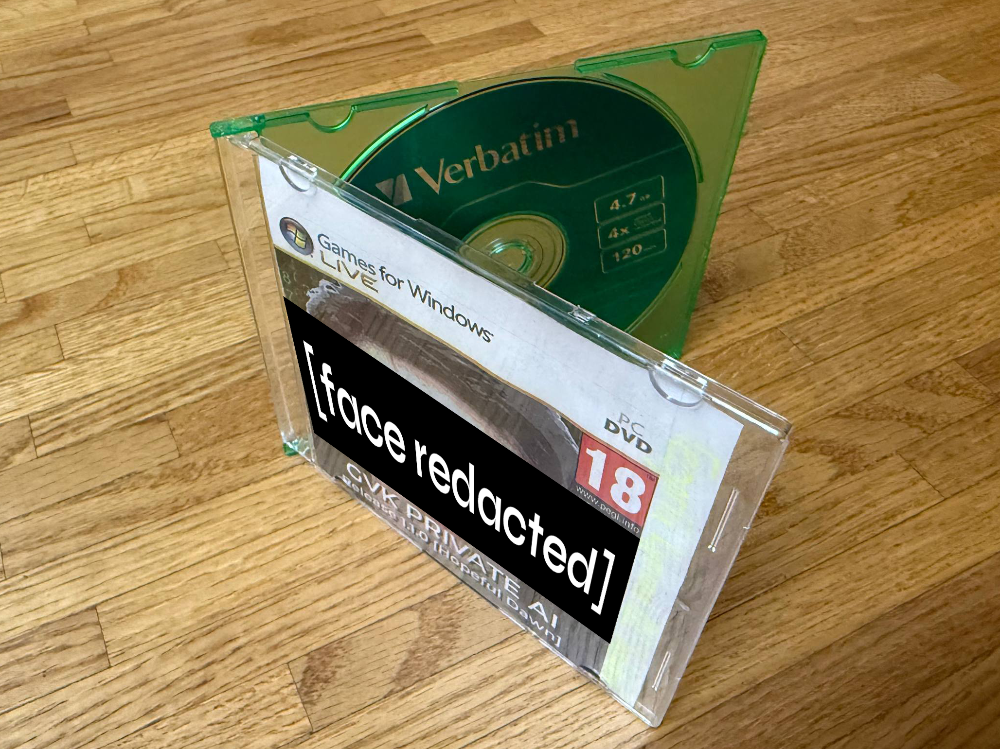

# GVK Private AI

**English** | [Українська](README.uk.md)

**GVK Private AI** is a private, offline local AI companion with a retro terminal interface—built as a personal way to preserve and, in a small way, immortalize the voices, humor, and shared memories of close friends.

Instead of relying on cloud chatbots, everything runs locally on your machine using one shared open-weight base model (`Qwen2.5-14B-Instruct`) paired with encrypted persona cartridges delivered on physical **DVDs or USB drives (`GVK_VAULT`)** that act as both storage and hardware access keys.

```text
┌─────────── GVK PRIVATE AI [Release 1.2.0 - Public Exorcism] ───────────┐
│  [Animated Braille Portrait] │ [You]                                   │
│  idle / talking / smiling /  │   /command or normal chat message       │
│  sleeping                    │                                         │
│──────────────────────────────│ [Persona]                               │
│  Name, dynamic age           │   Reply in the friend's own style,      │
│  Short dossier & vibe        │   grounded in shared RAG memories       │
│  RAG: 62 memories [OK]       │                                         │
│  Skills: active: 4 [OK]      │                                         │
│  • /command <arg> - desc     │─────────────────────────────────────────│
│  State: [IDLE]               │ > _                                     │
└──────────────────────────────┴─────────────────────────────────────────┘
```

<p align="center">
  <br>
  <em>Endless ways to craft a one-of-a-kind gift for your friends—paired with bespoke cover art and memories built to last.</em>
</p>

---

## Quick Start (Zero-Install)

No prior setup is needed—no Git, Python, Homebrew, or admin rights required.

* **Requirements:** Windows 10/11, macOS (ARM only), or Linux; **16+ GB RAM** recommended; **~12 GB free SSD space**.
* **Launch:**
  * **Windows:** double-click `run.bat` (on the `GVK_VAULT` DVD/USB or in a local clone).
  * **macOS:** double-click `run.command` in Finder, or run `./run.sh` in Terminal.
  * **Linux:** run `./run.sh`.
* **First launch vs. offline use:**
  * **From a `GVK_VAULT` USB drive:** needs a brief internet connection on the **first launch** to install/update Python dependencies (`requirements.txt`), while skipping the ~9.5 GB download by copying the bundled base model, `llama-server`, embeddings, and portable Python directly from the USB into `~/.gvk_ai`. Every launch after that runs **100% offline**.
  * **From a `GVK_VAULT` DVD or Git clone:** downloads the base model, runtime, and Python packages once (~9.5 GB into `~/.gvk_ai`), then runs **100% offline** on every launch after that (3–5 s warm start).

> [!NOTE]
> **About cloning this repository:** This public GitHub repository contains the **engine and persona-building tools**, not access to anyone's private personas. The encrypted containers live in `personas_encrypted/` and cannot be activated or decrypted without a shared `GVK_VAULT` cartridge (`origin.sig`) and its master key from the persona's creator. To use GVK Private AI, you either need someone to share a persona with you, or you can create your own by following the [Persona Creation Pipeline](docs/persona-pipeline.md).

### Useful Launcher Commands
```bash
./run.sh --fast       # Faster startup (short intro splash timers)
./run.sh status       # Inspect ~/.gvk_ai cache, .venv, models, and detected media
./run.sh self-test    # Run offline self-checks across core modules
```
*(Windows supports the same flags via `run.bat --fast`, `run.bat status`, and `run.bat self-test`.)*

---

## How It Works (In Plain Terms)

1. **Physical Cartridge (`GVK_VAULT` DVD or USB):** Holds an encrypted persona package (LoRA voice adapter, memories, portraits, prompt, and skills) plus a hardware key. Removing the disc/drive triggers the **Kill-Switch**, immediately stopping the model and wiping RAM.
2. **Local Computer:** Keeps only the public base model and encrypted containers on disk (`~/.gvk_ai`). Private persona files are decrypted strictly into an isolated RAM workspace during an active session—never left in plaintext on your SSD.
3. **Retro Terminal UI (`core/menu.py`):** A self-contained `1280x720` Tkinter terminal featuring animated Braille portraits, a live dossier, hybrid vector memory recall (RAG), and sandboxed `/skills` commands (`Ctrl+N` new chat, `Shift+Enter` newline, `Esc` back, `Ctrl+C` exit).

---

## Releases

* **`v1.1.0 - Hopeful Dawn`** — First complete encrypted persona release (`friend_1`), zero-install launchers, retro terminal GUI with animated Braille portraits, hybrid RAG memory, sandboxed persona skills, and `GVK_VAULT` DVD/ISO cryptographic delivery.
* **`v1.1.1 - Optical Funeral`** — Added full offline **USB flash drive mode** alongside the DVD pipeline (bundled base model, multi-platform `llama-server`, embeddings, and portable Python), unified `roster.json` loading (`core/roster.py`), and aligned the chat dossier layout.
* **`v1.2.0 - Public Exorcism`** — Public-readiness overhaul: unified all module headers, docstrings, comments, CLI help, notebook cells, and terminal logs into consistent English (`GVK Private AI -`), added [CONTRIBUTING.md](CONTRIBUTING.md) and sanitized config templates, and replaced the monolithic README with a bilingual hub and truthful `docs/`—so even the developers can finally understand their own documentation.

---

## Repository Layout

| Path | Purpose |
| :--- | :--- |
| `core/` | Runtime engine: crypto vault & RAM disk, orchestrator, RAG memory, skill sandbox, unified roster loader, and Tkinter terminal UI |
| `tools/` | Offline developer pipeline: Telegram dataset builder, QLoRA CLI trainer, GGUF converter, RAG builder, ASCII portrait generator, and DVD/USB packer |
| `notebooks/` | Google Colab A100 2-stage QLoRA training notebook (`Qwen2.5_14b_LoRA_trainer.ipynb`) |
| `personas_encrypted/` | Encrypted persona update containers (`*.enc` + public `manifest.json`; no plaintext secrets) |
| `hardware/` | Unfinished 3D prototype files for the `GVK-DOCK MK.I` concept console (planned for rework) |
| `docs/` | Detailed technical documentation (architecture, security, persona pipeline, hardware) |
| `run.sh`, `run.bat`, `updater.py` | Zero-install launchers and local cache/media synchronizer |

---

## Documentation

* [**Architecture & Security**](docs/architecture-and-security.md) — 3-contour design, DVD vs. offline USB modes, `Argon2id` / `AES-256-GCM` encryption, RAM isolation, Kill-Switch, and release history.
* [**Persona Creation Pipeline**](docs/persona-pipeline.md) — Step-by-step developer guide from friend questionnaires and Telegram exports to QLoRA training, RAG memories, Braille portraits, custom skills, config templates ([`roster.example.json`](docs/templates/roster.example.json), [`persona_config.example.json`](docs/templates/persona_config.example.json)), and DVD/USB packing.
* [**Hardware Dock (`GVK-DOCK MK.I`)**](docs/hardware-dock.md) — Early 3D dock prototype and planned rework notes.
* [**Contributing & Style Guide**](CONTRIBUTING.md) — Code, docstring, comment, CLI, and language boundary guidelines.

---

<sub>Disclaimer: The Ministry of Health of Ukraine warns that excessive consumption of GVK-generated content may be hazardous to your mental health. The GVK software suite is not designed, intended, or licensed for use in environments requiring fail-safe performance, and any unauthorized export, re-export, or transfer of this software to territories subject to UN or NSDC of Ukraine sanctions is strictly prohibited.</sub>
