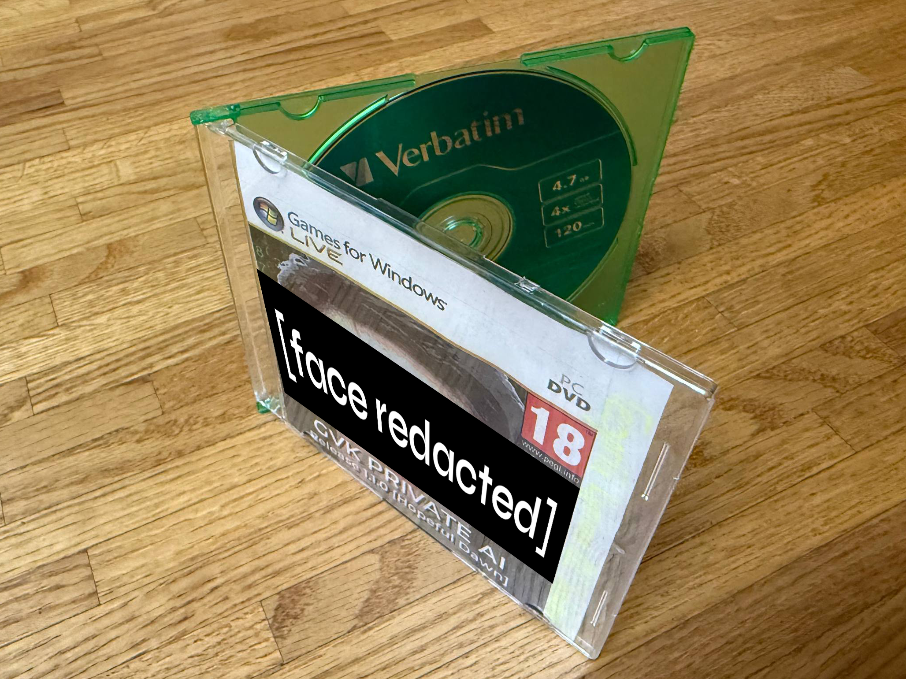

# GVK Private AI

[English](README.md) | **Українська**

**GVK Private AI** — це приватний офлайн AI-компаньйон із ретро-термінальним інтерфейсом, створений як особистий спосіб зберегти — і певною мірою увічнити — голоси, гумор та спільні спогади близьких друзів.

Замість хмарних чат-ботів усе працює локально на вашому комп'ютері на базі однієї спільної відкритої моделі (`Qwen2.5-14B-Instruct`) та зашифрованих «картриджів» особистостей на фізичних **DVD-дисках або USB-флешках (`GVK_VAULT`)**, які одночасно є носіями даних і апаратними ключами доступу.

```text
┌─────────── GVK PRIVATE AI [Release 1.2.0 - Public Exorcism] ───────────┐
│  [Анімований Braille-портрет]│ [Ви]                                    │
│  idle / talking / smiling /  │   /команда або звичайне повідомлення    │
│  sleeping                    │                                         │
│──────────────────────────────│ [Персонаж]                              │
│  Ім'я, динамічний вік        │   Відповідь у стилі друга               │
│  Коротке досьє та вайб       │   із підтягуванням спільних спогадів    │
│  RAG: 62 спогадів [OK]       │                                         │
│  Скіли: активних: 4 [OK]     │                                         │
│  • /команда <арг> - опис     │─────────────────────────────────────────│
│  Стан: [IDLE]                │ > _                                     │
└──────────────────────────────┴─────────────────────────────────────────┘
```

<p align="center">
  <br>
  <em>Безмежні можливості створити унікальний подарунок для друзів — із бездоганним дизайном та спогадами, що залишаться назавжди.</em>
</p>

---

## Швидкий запуск (Zero-Install)

Жодних попередніх встановлень не потрібно — ні Git, ні Python, ні Homebrew, ні прав адміністратора.

* **Вимоги:** Windows 10/11, macOS або Linux; рекомендовано **16+ ГБ RAM** та **~12 ГБ вільного місця на SSD**.
* **Запуск:**
  * **Windows:** двічі клікніть `run.bat` (на носії `GVK_VAULT` або в локальній папці репо).
  * **macOS:** двічі клікніть `run.command` у Finder або запустіть `./run.sh` у терміналі.
  * **Linux:** запустіть `./run.sh`.
* **Перший запуск та офлайн-робота:**
  * **З USB-флешки `GVK_VAULT`:** потребує короткого підключення до інтернету лише на **перший запуск**, щоб швидко встановити/оновити Python-бібліотеки (`requirements.txt`), водночас пропускаючи завантаження ~9.5 ГБ — базова модель, `llama-server`, RAG-ембедінги та портативний Python копіюються напряму з флешки у `~/.gvk_ai`. Усі наступні запуски працюють **100% офлайн**.
  * **З DVD `GVK_VAULT` або Git-клону:** одноразово завантажує базову модель, рантайм і Python-пакети (~9.5 ГБ у `~/.gvk_ai`), після чого працює **100% офлайн** на кожному запуску (теплий старт 3–5 с).

> [!NOTE]
> **Щодо клонування цього репозиторію:** Цей публічний GitHub-репозиторій містить **рушій та інструменти створення особистостей**, але не дає доступу до чужих приватних персонажів. Навіть попри наявність зашифрованих контейнерів у `personas_encrypted/`, їх неможливо активувати чи розшифрувати без переданого вам носія `GVK_VAULT` (`origin.sig`) та майстер-ключа від автора персонажа. Щоб користуватися GVK Private AI, вам або мають передати готову особистість, або ви можете створити власну за гайдом [Persona Creation Pipeline](docs/persona-pipeline.md).

### Корисні команди лаунчера
```bash
./run.sh --fast       # Прискорений запуск (короткі інтро-таймери)
./run.sh status       # Стан кешу ~/.gvk_ai, .venv, моделей і виявленого носія
./run.sh self-test    # Офлайн-самоперевірка модулів ядра
```
*(На Windows працюють ті самі команди через `run.bat --fast`, `run.bat status`, `run.bat self-test`.)*

---

## Як це працює (простими словами)

1. **Фізичний картридж (`GVK_VAULT` DVD або USB):** Містить зашифрований пакет особистості (LoRA-адаптер, спогади, портрети, промпт і скіли) та апаратний ключ. Виймання диска/флешки активує **Kill-Switch**, миттєво зупиняючи модель і затираючи RAM.
2. **Локальний ПК:** На SSD зберігаються лише публічна базова модель та зашифровані контейнери (`~/.gvk_ai`). Усі приватні файли особистості розшифровуються виключно в ізольований RAM-простір на час сесії й ніколи не лежать у відкритому вигляді на диску.
3. **Ретро-термінальний GUI (`core/menu.py`):** Автономне вікно Tkinter `1280x720` з анімованими Braille-портретами, досьє, гібридною векторною пам'яттю (RAG) та ізольованими `/skills` командами (`Ctrl+N` новий чат, `Shift+Enter` новий рядок, `Esc` назад, `Ctrl+C` вихід).

---

## Релізи

* **`v1.1.0 - Hopeful Dawn`** — Перший повноцінний зашифрований реліз особистості (`friend_1`), Zero-Install лаунчери, ретро-термінальний GUI з анімованими Braille-портретами, гібридна RAG-пам'ять, пісочниця скілів та криптографічна доставка на DVD/ISO `GVK_VAULT`.
* **`v1.1.1 - Optical Funeral`** — Додано повністю офлайн **USB-режим** поряд із DVD-пайплайном (вшита базова модель, мультиплатформний `llama-server`, ембедінги та портативний Python), уніфіковано завантаження `roster.json` (`core/roster.py`) і вирівняно панель досьє в чаті.
* **`v1.2.0 - Public Exorcism`** — Велике очищення перед публічним релізом: уніфіковано всі заголовки модулів, докстрінги, коментарі, CLI-довідку, ноутбук і логи в єдиному англійському стилі (`GVK Private AI -`), додано [CONTRIBUTING.md](CONTRIBUTING.md) і шаблони конфігів, а монолітний README розділено на двомовний хаб та актуальну `docs/` — щоб тепер навіть самі розробники нарешті розуміли власну документацію.

---

## Структура репозиторію

| Шлях | Призначення |
| :--- | :--- |
| `core/` | Ядро системи: крипто-сховище та RAM-диск, оркестратор, RAG-пам'ять, пісочниця скілів, завантажувач ростера й термінальний GUI |
| `tools/` | Офлайн-пайплайн розробника: білдер датасетів Telegram, CLI-тренер QLoRA, конвертер GGUF, збирач RAG, генератор ASCII-портретів і пакувальник DVD/USB |
| `notebooks/` | Google Colab A100 ноутбук 2-стадійного QLoRA-тренування (`Qwen2.5_14b_LoRA_trainer.ipynb`) |
| `personas_encrypted/` | Зашифровані контейнери оновлень (`*.enc` та публічний `manifest.json`; без відкритих секретів) |
| `hardware/` | Незавершений 3D-прототип настільної станції `GVK-DOCK MK.I` (запланований до переробки) |
| `docs/` | Детальна технічна документація англійською (архітектура, безпека, пайплайн, хардвер) |
| `run.sh`, `run.bat`, `updater.py` | Zero-Install лаунчери та синхронізатор локального кешу і носіїв |

---

## Детальна документація (English)

* [**Architecture & Security**](docs/architecture-and-security.md) — 3-контурна архітектура, режими DVD та офлайн USB, шифрування `Argon2id` / `AES-256-GCM`, ізоляція в RAM, Kill-Switch та історія релізів.
* [**Persona Creation Pipeline**](docs/persona-pipeline.md) — Покроковий гайд створення особистості: анкета друзів і біографічний леджер → експорт Telegram → QLoRA → GGUF → RAG → портрети → скіли → шаблони конфігів ([`roster.example.json`](docs/templates/roster.example.json), [`persona_config.example.json`](docs/templates/persona_config.example.json)) → пакування DVD/USB.
* [**Hardware Dock (`GVK-DOCK MK.I`)**](docs/hardware-dock.md) — Ранній 3D-прототип консолі та плани переробки.
* [**Contributing & Style Guide**](CONTRIBUTING.md) — Правила оформлення коду, докстрінгів, коментарів, CLI та мовної політики.

---

<sub>Застереження: Міністерство охорони здоров'я України попереджає, що надмірне споживання контенту, згенерованого «GVK», може шкодити вашому ментальному здоров'ю. Програмний комплекс GVK не розроблений, не призначений і не ліцензований для використання в умовах, що вимагають безвідмовної роботи, а будь-який несанкціонований експорт, реекспорт або передача цього програмного забезпечення на території держав, що перебувають під санкціями ООН або РНБО України, суворо заборонені.</sub>
