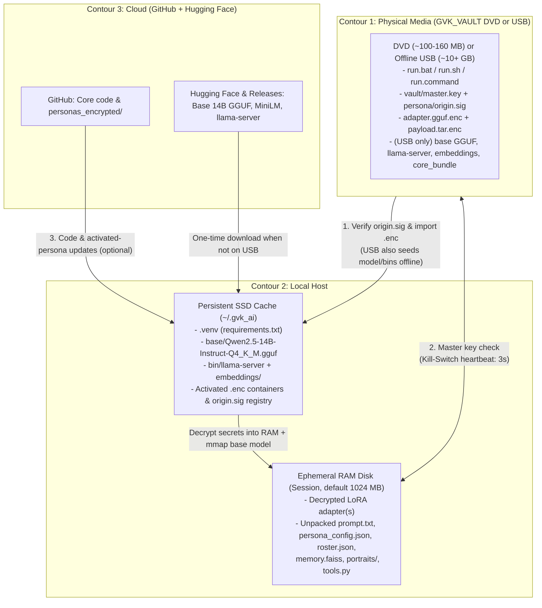

# GVK Private AI - Architecture & Security

This document describes the runtime architecture, delivery media modes (DVD and offline USB), cryptographic model, RAM isolation, and release history of **GVK Private AI**.

---

## 1. Three-Contour Architecture

GVK Private AI separates public code/models from private persona data across three layers:

1. **Physical Media (`GVK_VAULT` DVD or Offline USB)** — Acts as both the persona cartridge and the hardware access key (`vault/master.key` + `persona/origin.sig`).
2. **Local Host (SSD Cache + Ephemeral RAM Space)** — Stores public runtime assets and encrypted `.enc` containers in `~/.gvk_ai`, while decrypting private persona data strictly into an isolated in-memory session directory during runtime.
3. **Cloud Contour (GitHub + Hugging Face)** — GitHub hosts only anonymized core code (`core/`, `tools/`, `updater.py`, `run.sh`, `run.bat`) and encrypted persona containers (`personas_encrypted/`). Public weights (`Qwen2.5-14B-Instruct-Q4_K_M.gguf`), RAG embeddings, and `llama-server` binaries are downloaded once from Hugging Face / GitHub Releases unless already bundled on a USB drive.



---

## 2. DVD Mode vs. Offline USB Mode

`updater.py`, `run.sh`, and `run.bat` automatically detect the media type via `detect_media_mode()`:

| Aspect | DVD Mode (`GVK_VAULT`) | Offline USB Mode (`GVK_VAULT`) |
| :--- | :--- | :--- |
| **Typical Size** | ~100–160 MB (fits on DVD-R or CD-R) | ~10–12 GB (built for 32/64 GB flash drives) |
| **First Launch** | Requires internet once (~9.5 GB download for base model, `llama-server`, embeddings, portable Python, and Python packages) | Requires a brief internet connection once to install/update `requirements.txt` Python packages, while copying `core_bundle/`, portable Python, base GGUF, multi-platform `llama-server` binaries, and embeddings directly from USB into `~/.gvk_ai` |
| **Subsequent Launches** | 100% offline (3–5 s warm start) | 100% offline (3–5 s warm start) |
| **Builder Commands** | `disc_packer.py build-disc` / `build-iso` | `disc_packer.py fetch-usb-bins` + `build-usb` |

### Physical Media Layout

```text
GVK_VAULT/
├── run.bat / run.sh / run.command   # Zero-Install launchers (Windows / Linux / macOS)
├── vault/
│   ├── master.key                   # Raw 256-bit key (32 bytes)
│   └── media_mode.json              # Present on USB builds
├── persona/
│   ├── origin.sig                   # HMAC-SHA256(persona_id, master_key) (32 bytes)
│   ├── manifest.json                # Public ID, version, and SHA-256 hashes of .enc files
│   ├── adapter.gguf.enc             # Encrypted LoRA adapter
│   └── payload.tar.enc              # Encrypted archive: config, prompt, roster, portraits, RAG, tools
├── core_bundle/                     # (Optional / USB) Offline snapshot of repository core
├── base/                            # (USB) Qwen2.5-14B-Instruct-Q4_K_M.gguf
├── bin/                             # (USB) Multi-platform llama-server archives / runtime DLLs
├── embeddings/                      # (USB) paraphrase-multilingual-MiniLM-L12-v2 cache
└── python_portable/                 # (USB) Portable Python 3.12 + Tk archives
```

### Incremental Unlock & `updater.py`
* **Activation Guard (`origin.sig`):** Every physical medium contains `HMAC-SHA256(persona_id, master_key)`. `origin.sig` is never committed to GitHub.
* **Selective Updates:** `updater.py` only pulls encrypted updates from `personas_encrypted/` for personas whose `origin.sig` has already been registered locally in `~/.gvk_ai/registry/`, and never downgrades a newer local version with an older disc.
* **Shared Master Key:** Because `master.key` is shared across discs/drives for the same vault, inserting any single `GVK_VAULT` medium (or entering the master passphrase via Argon2id) unlocks all previously activated personas.

> [!IMPORTANT]
> **What happens if someone clones this public repository?**
> Cloning the repo gives anyone the full GVK Private AI runtime and pipeline tools so they can build their own personas—but they **cannot** unlock or run any encrypted persona in `personas_encrypted/`. Two independent locks protect shared personas:
> 1. **Missing `origin.sig`:** `updater.py` will not activate or sync an encrypted persona unless a physical `GVK_VAULT` medium carrying that persona's `origin.sig` has been presented.
> 2. **Missing `master.key` / passphrase:** Without the 256-bit key (or 24+ character Argon2id passphrase) shared by the creator, `adapter.gguf.enc` and `payload.tar.enc` remain unreadable `AES-256-GCM` ciphertext.

---

## 3. Cryptography & Zero-Plaintext-At-Rest

No plaintext LoRA weights, prompts, real names (`roster.json`), memory indexes, portraits, or personal skills are committed to Git or stored unencrypted on the host SSD. System prompts are also excluded from session logs in `logs/`.

### Key Derivation & Container Format (`tools/disc_packer.py`)
* **Key Derivation:** `Argon2id` over a 24+ character passphrase with fixed domain salt `GVK_PRIVATE_AI_DOMAIN_SALT_2026` (`time_cost=4`, `memory_cost=262144` KiB / 256 MB RAM, `parallelism=4`, `hash_len=32`) produces the 32-byte `master.key`.
* **Discless Fallback:** If no `GVK_VAULT` medium is attached, `core/crypto_vault.py` prompts for the passphrase in the terminal and derives the identical 32-byte key in memory.
* **Streaming `.enc` Container (36-byte header + 64 MB `AES-256-GCM` chunks):**

```text
+------------------+-------------------+-------------------+-------------------+------------------------+
| Magic Bytes (4B) |  Base Nonce (12B) |  Header Tag (16B) |  Chunk Size (4B)  |   Ciphertext (N B)     |
|     "GVK1"       |  os.urandom(12)   |  HMAC-SHA256[:16] |  uint32 (64 MB)   | AES-256-GCM chunks     |
+------------------+-------------------+-------------------+-------------------+------------------------+
```

Each chunk uses a unique nonce derived from `base_nonce XOR chunk_index` and authenticates the header and chunk index via AEAD.

### Dual-Manifest Privacy & Roster Bundling
* **Public `manifest.json`:** Contains only anonymized `persona_id` (e.g., `friend_1`), package `version`, `.enc` filenames, and their `SHA-256` digests.
* **Encrypted `payload.tar.enc`:** Contains `persona_config.json`, `prompt.txt`, `memory.faiss`, `portraits/`, `tools.py`, and the shared `roster.json` (auto-bundled from `../roster.json` by `disc_packer.py` and loaded centrally via `core/roster.py`). Packaging automatically excludes hidden/temp files, `__pycache__/`, `raw/`, `.psd`, `.xcf`, and `.pyc`.

### RAM Isolation & Kill-Switch (`core/crypto_vault.py`)
* **Linux:** `tmpfs` directory under `/dev/shm/gvk_runtime_<pid>` (`chmod 700`).
* **macOS:** RAM block device via `hdiutil attach -nomount ram://<sectors>` formatted HFS+ (`0700`, `nobrowse,noowners,nosuid`, Spotlight disabled with `mdutil -i off` + `.metadata_never_index`), with a zero-wiped fallback buffer inside restricted sandboxes.
* **Windows:** `ImDisk` virtual RAM disk when installed, or an isolated `0700` session buffer with read-only stripping and explicit `0x00` byte-level overwrite on teardown.
* **Memory Footprint (16 GB Host Friendly):** The public ~9.0 GB base model stays on SSD and is mapped directly into `llama-server` via `--mmap`; only private persona files are decrypted into the RAM disk (default `1024 MB`).
* **Kill-Switch Daemon:** Checks for `vault/master.key` on the mounted medium every `3.0` seconds. If the medium is removed, the daemon terminates `llama-server`, overwrites keys and session files with `0x00`, and unmounts the RAM disk.

---

## 4. Storage & Asset Breakdown

| Component | Format | Typical Size | Storage Location |
| :--- | :--- | :--- | :--- |
| **Base Model (`Qwen2.5-14B-Instruct`)** | `GGUF Q4_K_M` | ~9.0 GB | Hugging Face / USB → `~/.gvk_ai/base/` |
| **RAG Encoder (`paraphrase-multilingual-MiniLM-L12-v2`)** | SentenceTransformers | ~470 MB | Hugging Face / USB → `~/.gvk_ai/embeddings/` |
| **Encrypted Persona LoRA (`friend_1`)** | `GGUF` inside `.enc` | ~100 MB | DVD / USB / GitHub → `~/.gvk_ai/personas/` → RAM |
| **Encrypted Persona Payload (`friend_1`)** | `TAR.GZ` inside `.enc` | ~150 KB – 25 MB | DVD / USB / GitHub → `~/.gvk_ai/personas/` → RAM |
| **Inference Engine (`llama-server`)** | Native binary + libs | ~30 – 750 MB | GitHub Releases / USB → `~/.gvk_ai/bin/` |

---

## 5. Privacy & Version Control Boundary (`.gitignore`)

* **Git-tracked (`core/`, `tools/`, `notebooks/`, `hardware/`, `updater.py`, `run.*`, `docs/`):** Anonymized code, pipeline scripts, and documentation only.
* **Git-tracked encrypted (`personas_encrypted/`):** Encrypted `.enc` containers and public `manifest.json` files (currently `friend_1`; `origin.sig` is strictly git-ignored).
* **Strictly git-ignored:** Plaintext `personas/`, `raw_chats_and_prompts/`, `data/`, `datasets/`, `logs/`, `backups/`, `vault/`, `dist/`, `*.iso`, `base/`, `adapters/`, `lora_final/`, and `.venv/`.

---

## 6. Release History

* **`v1.1.0 - Hopeful Dawn`** — First full end-to-end encrypted persona release (`friend_1`), featuring the Zero-Install launchers (`run.sh` / `run.bat`), retro Tkinter terminal GUI (`core/menu.py`) with animated Braille portraits, hybrid vector/lexical RAG (`core/memory_rag.py`), 3-tier sandboxed persona skills (`core/skill_runner.py`), and `GVK_VAULT` DVD/ISO cryptographic packaging.
* **`v1.1.1 - Optical Funeral`** — Added full offline **USB flash drive mode** alongside the DVD pipeline (`detect_media_mode()`, `disc_packer.py build-usb` / `fetch-usb-bins`, offline `core_bundle/`, portable Python, base model, multi-platform `llama-server` binaries, and bundled embeddings), fixed `llama.cpp` release binary fallback lookup, unified `roster.json` loading in `core/roster.py`, and synced the chat dossier layout with the portrait pane.
* **`v1.2.0 - Public Exorcism`** — Public-readiness & documentation overhaul: unified all module headers, docstrings, inline comments, CLI `--help`, notebook cells, and terminal/logger outputs into consistent English (`GVK Private AI -`), added root `CONTRIBUTING.md` and sanitized JSON config templates (`docs/templates/`), removed the obsolete Issue #1 checklist workflow, and split the monolithic README into a slim bilingual hub (`README.md` / `README.uk.md`) + truthful `docs/` so even the developers can finally understand their own documentation.
