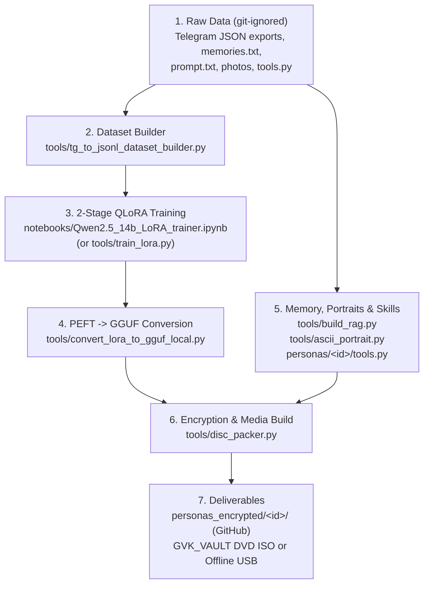

# GVK Private AI - Persona Creation & Distribution Pipeline

This guide walks through the end-to-end developer workflow for turning raw chat history and persona assets into an encrypted `GVK_VAULT` package (for DVD, ISO, or offline USB).

---

## Pipeline Overview



---

## Step 0 - Lore, Friend Questionnaire & Config Templates

Before touching raw chat exports, two practical habits dramatically improve how alive and grounded the final persona feels (learned empirically while building `friend_1`):

### 0.1 Build a Unified Biography Ledger (with a Friend Questionnaire)
Chat logs alone capture *how* someone talks, but often scatter facts across years of inside jokes. Before writing `prompt.txt` or `memories.txt`:
1. **Circulate a short questionnaire** to mutual friends who know the person well (favorite stories, recurring habits, pet peeves, inside jokes, shared trips, how they react under stress, nicknames, music/games/food preferences).
2. **Compile one unified biography ledger** (e.g., `raw_chats_and_prompts/<persona>/biography_ledger.txt`, git-ignored) combining factual bio milestones with those friend perspectives.
3. **Derive both core text files from the ledger:**
   * **`personas/<id>/prompt.txt`** — Distilled personality core, tone, boundaries, speech habits, and key relationships.
   * **`data/memories.txt`** — Structured `[MEMORY_XX]` recall cards fed into the RAG builder (Step 4). Keeping both grounded in the same ledger prevents the system prompt and retrieved memories from contradicting each other.

### 0.2 Initialize `roster.json` and `persona_config.json`
Neither file is committed to Git (both are private and git-ignored). Start from the sanitized templates in `docs/templates/`:

| Template | Copy To (git-ignored) | Purpose |
| :--- | :--- | :--- |
| [roster.example.json](templates/roster.example.json) | `personas/roster.json` | Shared UI user picker (`users_dict`), persona menu (`persona_select_items`), UI-to-prompt name map (`ua_to_ru_names`), interlocutor descriptions, and startup splash/warning screens. Auto-bundled into `payload.tar.enc` by `disc_packer.py`. |
| [persona_config.example.json](templates/persona_config.example.json) | `personas/<id>/persona_config.json` | Per-persona identity, `birth_date` (dynamic age), `llama-server` sampling & `lora_scaled` parameters, emotion sprite mapping, private `rag_lexicon` synonyms, Cross-Talk triggers, and `/skill` dossier metadata. |

---

## Step 1 - Build the ChatML Dataset (`tools/tg_to_jsonl_dataset_builder.py`)

Converts raw Telegram Desktop JSON chat exports into a chronologically ordered, weighted ChatML `.jsonl` dataset.

### Why Personal Chats and Group Chats Must Be Separated
Always configure each exported JSON file explicitly as `"type": "personal"` (1-on-1) or `"type": "group"` inside your `--config` file—and **never merge them into one flat stream**:
* People speak differently in 1-on-1 DMs (more direct, personal, unprefixed) than in chaotic multi-person group chats (shorter quips, reacting to specific speakers).
* In **personal chats**, user turns remain clean unprefixed text and get the `PERSONAL_PROMPT_TEMPLATE` directive (`Собеседник в этом диалоге: {description}.`).
* In **group chats**, every non-assistant message is mapped via `user_id_map` and prefixed as `[Name]: text`, while the assistant's own replies stay **unprefixed**, paired with `GROUP_PROMPT_TEMPLATE` instructing the model to read prefixed group turns and answer naturally without adding its own prefix. Keeping the two chat types strictly isolated prevents the model from leaking `[Name]:` prefixes into 1-on-1 chats or losing personal conversational tone.

### How `tg_to_jsonl_dataset_builder.py` Works Under the Hood
Each chat file in `chats_config` passes independently through a deterministic 7-stage pipeline:

1. **Private Config Resolution (`--config`):** Loads `assistant_from_id`, `user_id_map`, `chats_config` (`filename -> {type, description}`), session/chunk sizes, and epoch weights from a local git-ignored JSON config (auto-discovered at `data/builder_config_<persona>.json` or passed via `--config`).
2. **Message Extraction & Media Placeholders:** Flattens Telegram rich-text entity arrays, labels forwarded messages (`[Пересланное сообщение от ...]: text`), and replaces captionless photos, voice notes, video circles, stickers, files, polls, and locations with structured semantic placeholders.
3. **Strict Per-Chat Isolation & Turn Consolidation:** Splits each chat independently into sessions whenever a gap exceeds `SESSION_IDLE_TIMEOUT_MINUTES` (default `15` minutes), maps `assistant_from_id -> "assistant"` and all other mapped participants `-> "user"`, and merges consecutive bursts from the same role into single newline-joined turns (discarding unmapped unknown sender IDs cleanly).
4. **Assistant Text Integrity ("Golden Rules") & Hygiene:**
   * **Golden Rule 1:** If an assistant turn mixes real text with a naked media placeholder (e.g., a sticker + text), the naked placeholder line is stripped so the model only learns real speech.
   * **Golden Rule 2:** If an assistant turn contained *only* naked media/voice with no text, that `(user, assistant)` exchange is dropped and the session is **split in two** at that point so no phantom context leap occurs.
   * **Orphan Media Reactions:** Drops `(user, assistant)` pairs where the user sent media and the assistant replied only with uninformative reactions (e.g., "doesn't load", "show me", "resend").
   * **VoIP / Discord Noise Filter:** Drops entire sessions dominated by voice-call troubleshooting (`VOICE_METATALK_PATTERNS` — any match in sessions `<= 4` turns, or `>= 50%` matching turns in longer sessions).
5. **Sliding-Window Chunking (`MAX_TURNS_PER_SAMPLE = 32`, `CHUNK_OVERLAP_TURNS = 4`):** Long sessions are sliced into overlapping windows so multi-turn context carries across chunk boundaries, with every emitted sample guaranteed to start on `user` and end on `assistant`.
6. **Per-Chat System Prompt Injection:** Prepends the base `prompt.txt` / `training_system_prompt.txt` combined with the chat's `personal` or `group` interlocutor directive.
7. **Global Chronological Sort & Temporal Weighting:** Sorts all samples across all chats earliest-first, then applies integer epoch multipliers (`WEIGHT_PRE_2022 = 0`, `WEIGHT_2022_2024 = 1`, `WEIGHT_POST_2024 = 1` by default — setting `0` drops outdated eras, while `2+` emphasizes recent speech style).

```bash
# Validate the dataset builder offline
python3 tools/tg_to_jsonl_dataset_builder.py self-test

# Build a persona dataset from a local private config
python3 tools/tg_to_jsonl_dataset_builder.py --config data/builder_config_friend_1.json
```

---

## Step 2 - Train the 2-Stage QLoRA Adapter

### Option A: Google Colab A100 (Recommended)
Open [Qwen2.5_14b_LoRA_trainer.ipynb](../notebooks/Qwen2.5_14b_LoRA_trainer.ipynb) in Google Colab with an **A100 GPU** and run Steps 1–13 sequentially:
* **Base model:** `unsloth/Qwen2.5-14B-Instruct-bnb-4bit` (`MAX_SEQ_LENGTH = 4096`).
* **LoRA config:** Attention-only (`q_proj`, `k_proj`, `v_proj`, `o_proj`), `r = 32`, `alpha = 48` (`alpha / r = 1.5`), `dropout = 0.0` to preserve base-model knowledge while locking in persona voice.
* **Loss masking:** Assistant turns only (`train_on_responses_only`).
* **Leak-free split:** Unshuffled 5% per interlocutor/chat bucket so adjacent sliding-window turns never leak into validation.
* **Stage 1 (Base & Vocabulary):** Full dataset, `lr = 1.0e-4`, cosine schedule, effective batch size `8`.
* **Stage 2 (Style Annealing):** Top 20% deduplicated modern short-reply chunks (`STAGE2_TOP_FRACTION = 0.20`), `lr = 2e-5`, cosine schedule, `weight_decay = 0.05`.
* **Output:** Exports HuggingFace PEFT weights (`lora_final/`) to Google Drive.

### Option B: Local / Cloud GPU CLI (`tools/train_lora.py`)
```bash
# Offline dataset validator and split self-test (no GPU required)
python3 tools/train_lora.py self-test

# Train a single persona dataset on GPU
python3 tools/train_lora.py train --dataset datasets/friend_1.jsonl --output-dir lora_final
```

---

## Step 3 - Convert PEFT Adapter to GGUF (`tools/convert_lora_to_gguf_local.py`)

Converts the exported HuggingFace PEFT folder (`lora_final/`) into a `llama.cpp`-compatible GGUF LoRA adapter (`adapters/<persona_id>.gguf`, ~96–135 MB). Downloads only lightweight base-model config/tokenizer files (~10 MB) rather than the full 14B weights.

```bash
python3 tools/convert_lora_to_gguf_local.py self-test
python3 tools/convert_lora_to_gguf_local.py --persona friend_1 --input lora_final --output adapters/friend_1.gguf
```

---

## Step 4 - Build Vector Memory RAG (`tools/build_rag.py`)

Compiles structured `[MEMORY_XX]` memory blocks (or `.txt` / `.md` / `.json` / `.jsonl`) into a standalone `memory.faiss` file.

* **Primary backend:** `sentence-transformers/paraphrase-multilingual-MiniLM-L12-v2` (384-dim, `faiss.IndexFlatIP`, similarity threshold `0.72`) paired with cross-lingual UA/RU/Surzhyk lexical boosting (optional persona-specific synonyms live in `persona_config.json -> rag_lexicon`).
* **Offline fallback:** Deterministic 384-dim n-gram feature hashing (`GVKRAG01`).
* **Self-contained index:** Metadata is embedded directly inside `memory.faiss` via the `GVKMETA1` binary trailer so no sidecar JSON is needed inside `payload.tar.enc`.

```bash
python3 tools/build_rag.py -i data/memories.txt -o personas/friend_1/memory.faiss
python3 core/memory_rag.py self-test --backend ngram
```

---

## Step 5 - Generate ASCII / Braille Emotion Portraits (`tools/ascii_portrait.py`)

Converts source photos into high-contrast Braille/ASCII sprites for the left panel of the terminal GUI (`idle`, `sleeping`, `smiling`, `talking`, `talking2`).

```bash
python3 tools/ascii_portrait.py self-test
python3 tools/ascii_portrait.py --init-pack personas/friend_1/portraits/raw/ --out-dir personas/friend_1/portraits/
```

---

## Step 6 - Author Persona Skills (`core/skill_runner.py`)

Each persona can optionally ship a private `personas/<id>/tools.py` file containing Python functions decorated with `@skill`. Skills execute inside a 3-tier sandbox:

1. **Static AST validation:** Allows only safe standard-library modules (`math`, `random`, `datetime`, `hashlib`, `re`, `json`, etc.) and blocks `os`, `subprocess`, `open`, `eval`, and dunder escapes.
2. **Restricted builtins:** Strips unsafe globals and file/network primitives.
3. **Isolated subprocess:** Enforces a `3.0 s` timeout and `2000`-character output cap.

Skills can be invoked via explicit `/slash` commands (including built-in `/skills` / `/скіли` / `/help`), natural-language keyword triggers, or safe `[SKILL: func(arg=val)]` LLM fallback tags.

```python
@skill(
    triggers=["чек", "розділити рахунок"],
    description="Splits a bill evenly between participants.",
    slash="/чек",
    slash_aliases=["/split"],
    usage="/чек <amount> [people]",
    short_desc="splits a bill",
)
def calc_split(total: float, people: int = 2) -> str:
    return f"По {round(total / people, 2)} з кожного"
```

---

## Step 7 - Runtime Wiring & Local Testing

Before encrypting, verify your local plaintext persona directory (`personas/<id>/` + shared `personas/roster.json` + `adapters/<id>.gguf`):

```bash
# Run individual module self-tests
python3 core/orchestrator.py self-test
python3 core/skill_runner.py self-test
python3 core/menu.py self-test

# Launch locally in fast mode
python3 core/main.py --fast
```

`core/orchestrator.py` launches `llama-server` using per-persona sampling settings from `persona_config.json`, injects dynamic date/age (`birth_date`), interlocutor context from `core/roster.py`, 2-turn RAG lookups, and writes server output to `logs/llama_server.log`.

---

## Step 8 - Encrypt & Package Physical Media (`tools/disc_packer.py`)

### 8.1 Generate Master Key & Encrypted Persona Package
```bash
# 0. Verify crypto and ISO/USB builder self-tests
python3 tools/disc_packer.py self-test

# 1. Derive 32-byte master.key (passphrase prompted securely)
python3 tools/disc_packer.py keygen -o vault/master.key

# 2. Encrypt adapter + payload (auto-bundles sibling ../roster.json)
python3 tools/disc_packer.py pack-persona \
  -k vault/master.key \
  --id friend_1 \
  --adapter adapters/friend_1.gguf \
  --payload-dir personas/friend_1/ \
  -o personas_encrypted/friend_1/
```

### 8.2 Build a DVD Tree & ISO-9660/Joliet Image
```bash
python3 tools/disc_packer.py build-disc \
  -k vault/master.key \
  --id friend_1 \
  --persona-dir personas_encrypted/friend_1/ \
  -o dist/GVK_VAULT_DISC_1/

python3 tools/disc_packer.py build-iso \
  -i dist/GVK_VAULT_DISC_1/ \
  -o dist/GVK_VAULT_DISC_1.iso \
  --volume-name GVK_VAULT
```

### 8.3 Build a Fully Offline USB Flash Drive (`v1.1.1+`)
```bash
# Optional: pre-download multi-platform llama.cpp binary archives
python3 tools/disc_packer.py fetch-usb-bins -o base/llama_bins

# Assemble complete offline USB root (bundles base GGUF, binaries, core_bundle, embeddings)
python3 tools/disc_packer.py build-usb \
  -k vault/master.key \
  --id friend_1 \
  --persona-dir personas_encrypted/friend_1/ \
  -o dist/GVK_VAULT_USB/ \
  --fetch-bins
```
